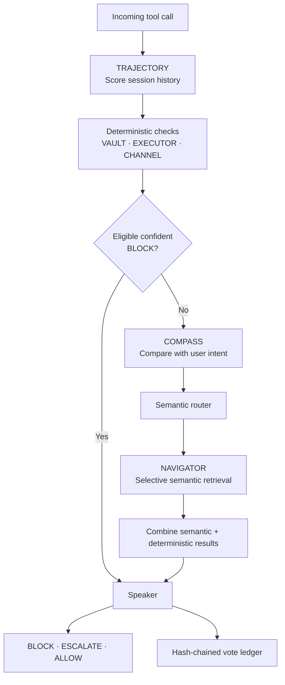

# Kavach

Kavach is a tool-call security monitor. This repository preserves the original `Ishani018/Kavach` implementation, including the ministers, selective routing, Speaker mechanism, supporting modules, and tests.

## How it works



**Routing matters:** VAULT, EXECUTOR, and CHANNEL deterministic checks run on every request. Eligible confident deterministic blocks can short-circuit the expensive synchronous path. Otherwise COMPASS runs and the semantic router decides whether NAVIGATOR retrieval is needed. If no router description crosses the configured threshold, the router falls back to all configured names; the live semantic retrieval path is NAVIGATOR. The Speaker combines the results and trajectory risk.

## Where to open the code

| Component | File / function |
|---|---|
| VAULT | [`parliament/prefilters.py`](parliament/prefilters.py) → `check_vault()` |
| EXECUTOR | [`parliament/prefilters.py`](parliament/prefilters.py) → `check_executor()` |
| CHANNEL | [`parliament/channel_taint.py`](parliament/channel_taint.py) → `check_channel_taint()` |
| NAVIGATOR retrieval | [`parliament/ministers.py`](parliament/ministers.py) |
| Routing + COMPASS + request flow | [`parliament/server.py`](parliament/server.py) |
| TRAJECTORY | [`parliament/trajectory.py`](parliament/trajectory.py) |
| Speaker decision | [`parliament/speaker.py`](parliament/speaker.py) → `combine_verdicts()` |
| Parsing helpers | [`parliament/ast_parse.py`](parliament/ast_parse.py), [`parliament/struct_parse.py`](parliament/struct_parse.py) |
| Provenance / denial protection | [`parliament/provenance.py`](parliament/provenance.py), [`parliament/denial_shield.py`](parliament/denial_shield.py) |

The original modules stay in their existing locations. VAULT and EXECUTOR share `prefilters.py); CHANNEL and provenance tracking share `channel_taint.py`. This README maps the existing implementation rather than duplicating or simplifying its logic.

## Run

The FastAPI service entry point is `parliament.server:app`:

```bash
pip install -r requirements.txt
python -m uvicorn parliament.server:app --host 127.0.0.1 --port 8088
```

The live service also needs the configured embedding model and ChromaDB collections. Installing dependencies alone does not create those resources.

## Tests

```bash
python -m pytest parliament/test_*.py
```

These are the original focused tests; their presence here does not imply that the suite or a fully configured live service has been run and verified.
