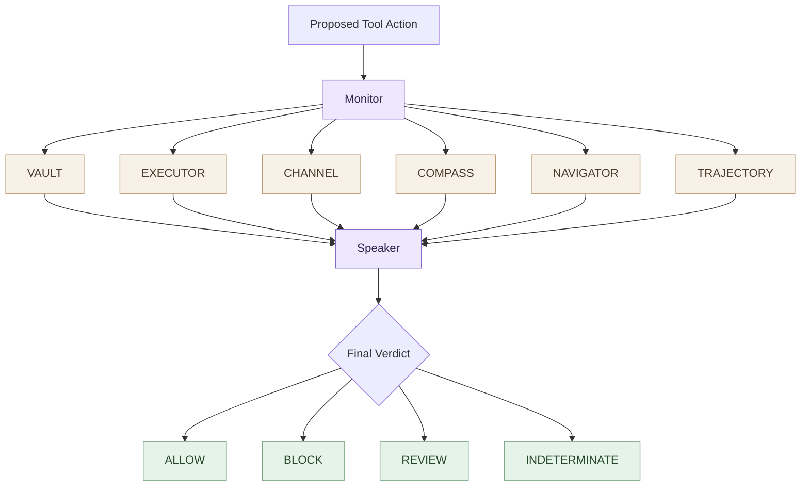

# Kavach

**A small set of security ministers, one Speaker.**

Each minister checks one kind of risk in a proposed tool action. The Speaker collects their votes and produces one final verdict. That's the whole architecture.

## Where to look

- `src/kavach/ministers/` — one small, readable file per minister.
- `src/kavach/speaker.py` — the only place that combines votes.
- `src/kavach/monitor.py` — calls the ministers and passes their votes to the Speaker.
- `src/kavach/models.py` — the shared input, vote, and verdict types.
- `tests/` — checks the Speaker's decision rules.

Each minister is intentionally a stub right now. Its job and extension point are visible, but no detection capability is claimed until it has implementation and tests.

No agent framework, web server, database, embeddings, LLM judge, or orchestration layer in the core.
