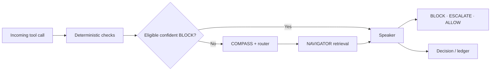

# Kavach

Kavach is a tool-call security monitor. This repository is the **Revamp working copy**; the original `Ishani018/Kavach` repository remains the source of truth and is not modified here.

## Current request path



VAULT and EXECUTOR checks live in `parliament/prefilters.py`; CHANNEL checks live in `parliament/channel_taint.py`; NAVIGATOR retrieval lives in `parliament/ministers.py`. The existing server also uses COMPASS, trajectory risk, and the Speaker. Those orchestration components have **not** been redesigned in this cleanup pass.

## Core files

| Responsibility | File |
|---|---|
| HTTP service, routing, orchestration | `parliament/server.py` |
| NAVIGATOR retrieval | `parliament/ministers.py` |
| VAULT + EXECUTOR deterministic checks | `parliament/prefilters.py` |
| CHANNEL taint checks | `parliament/channel_taint.py` |
| Provenance helpers | `parliament/provenance.py` |
| AST parsing | `parliament/ast_parse.py` |
| Structural parsing and fallback helpers | `parliament/struct_parse.py` |
| Existing Speaker policy | `parliament/speaker.py` |
| Existing trajectory implementation | `parliament/trajectory.py` |
| Runtime thresholds and model settings | `parliament/config.yaml` |
| Router descriptions | `kavach_router_config.json` |

VAULT, EXECUTOR, CHANNEL, and NAVIGATOR implementation files have been preserved rather than rewritten. The cleanup removed unconnected experimental modules from this working copy: the standalone LLM tie-breaker, alternate Bayesian Speaker, NAVIGATOR auth-flow experiment and its standalone test, and the unused denial-shield module. They remain recoverable from the original repository/history if later needed.

## Run

Use Python 3.11 and install dependencies:

```bash
python -m venv .venv
source .venv/bin/activate
pip install -r requirements.txt
python -m uvicorn parliament.server:app --host 127.0.0.1 --port 8088
```

The live service also requires the configured embedding model and ChromaDB collections; installing packages alone does not create those resources.

## Tests

```bash
python -m pytest parliament/test_*.py
```

This command describes the focused test suite available in the repository; it does not claim that the suite or a fully configured service has been run in this environment.
