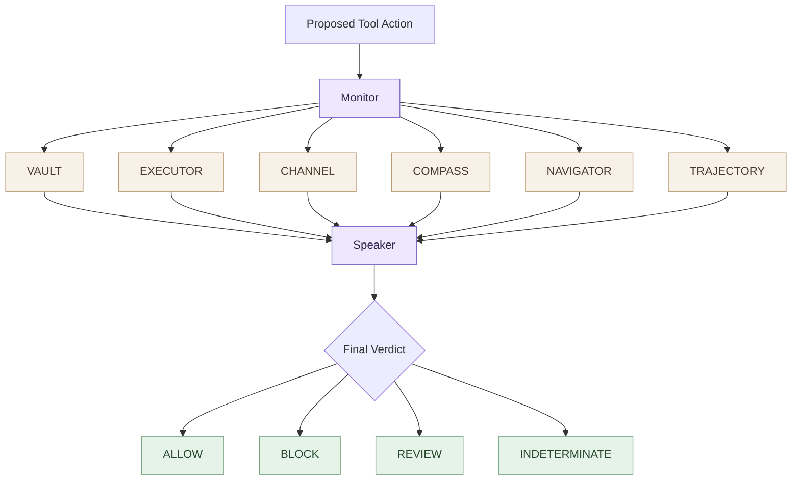

# Kavach

**Six small security ministers. One Speaker.**

Each minister checks one kind of risk in a proposed tool action and returns a vote. The Speaker combines those votes into one verdict. The Monitor only wires them together.



## The ministers

| File | Responsibility | Current mechanism |
|---|---|---|
| `ministers/vault.py` | Secret and credential access | Explicit credential-path and secret-format rules |
| `ministers/executor.py` | Dangerous command execution | Explicit command/code-execution patterns |
| `ministers/channel.py` | Sensitive read followed by external send | Session-local taint tracking |
| `ministers/compass.py` | Action versus user intent | Small lexical-overlap heuristic; REVIEW only |
| `ministers/navigator.py` | Prompt-injection indicators | Explicit instruction-hijack patterns |
| `ministers/trajectory.py` | Risk across a sequence of actions | Small session-history heuristic |

## Where the logic lives

- `src/kavach/ministers/` — one readable file per minister.
- `src/kavach/speaker.py` — the only place that combines votes.
- `src/kavach/monitor.py` — runs all six ministers, then calls the Speaker.
- `src/kavach/models.py` — shared action and vote types.
- `tests/` — malicious and benign examples.

## Speaker rules

1. Any `BLOCK` vote means `BLOCK`.
2. Otherwise, any `REVIEW` vote means `REVIEW`.
3. Otherwise, any `ABSTAIN` vote means `INDETERMINATE`.
4. `ALLOW` requires every minister to explicitly allow.

## Run the tests

```bash
python -m pip install -e .
python -m unittest discover -s tests -v
```

## Important limitation

This revamp uses intentionally small, inspectable rules. In particular, NAVIGATOR is **not** the original embedding/retrieval detector, and COMPASS is **not** a semantic intent model. These are first-pass heuristics, not production-validated security coverage. Each rule needs broader attack and benign regression tests before deployment.
