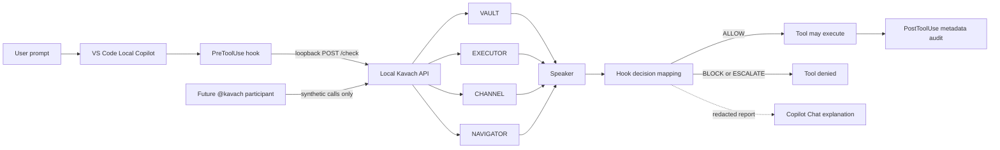

# Local Copilot integration and visual demo roadmap

**Date:** 2026-10-14  
**Scope:** VS Code's Local agent harness, the existing Kavach loopback API, and a demonstrable workflow inside Copilot Chat.

## Executive recommendation

Keep Kavach's existing Local `PreToolUse` hook as the enforcement boundary. Make the user experience richer around that boundary rather than replacing it with an AI prompt, a dashboard-only check, or a second policy engine.

The next three milestones should be:

1. **Reduce the known false positive narrowly.** A live harmless `python3 -c "print('KAVACH_TEST')"` currently escalated through NAVIGATOR `POL-007`. Teach the constrained shell approximation to recognize only a literal-only `print(...)` Python subset; keep arbitrary inline Python, command chaining, substitutions, and redirections indeterminate.
2. **Add a guided `Kavach Demo` custom agent.** Run one verified scenario at a time directly through the existing Local hook and show the actual four-minister report in the same chat. The agent instructions are in `.github/agents/kavach-demo.agent.md`.
3. **Build a small VS Code Chat Participant for the polished demo.** Use chat-native buttons and streamed Markdown to show the current API result as a decision trace. Its demo buttons should submit synthetic safe tool-call records to the local `/check` endpoint and must never execute the described action themselves. Keep the Local pre-tool hook authoritative for real agent tool calls.

## What exists today

- The Python API exposes `/check` and evaluates VAULT, EXECUTOR, CHANNEL, NAVIGATOR, then Speaker.
- `.github/hooks/kavach.json` wires `UserPromptSubmit`, `PreToolUse`, and `PostToolUse` to `scripts/kavach_vscode_hook.py`.
- The Local pre-tool hook sends calls to loopback only, validates the API response, writes a private metadata audit record, emits `systemMessage` for the user, and adds a privacy-safe report to model context.
- `ALLOW` maps to Local `allow`; `BLOCK` maps to `deny`; `ESCALATE` also maps to `deny` until approval prompting is independently verified. This is intentionally fail-closed.
- The current web dashboard has Overview, Evaluate, and Rule Archive views. Evaluate calls the live API and shows each minister; it is useful for inspection but is not yet a guided demo/story.
- Local hook coverage is not universal. Do not claim automatic protection for Agent Host, Cloud, external tools, or arbitrary MCP servers from this adapter alone.

## P0 — correctness before polish

Observed issue: a pure literal Python print command was escalated by NAVIGATOR as `POL-007`, because the zsh/dash approximation rejected quoted arguments. The constrained fix is merged via PR #9 and its full runtime test workflow passed. The real Local-harness result still needs verification on the developer's machine before calling the end-to-end behavior fixed.

Regression gates:

- `git status --short` remains ALLOW.
- `python3 --version` remains ALLOW.
- `python3 -c "print('KAVACH_TEST')"` may ALLOW only under the narrow static-print subset.
- `python3 -c "import os; os.system('echo KAVACH_TEST')"` remains BLOCK by EXECUTOR; do not count NAVIGATOR's coverage escalation as the primary detection.
- `pwd && whoami` remains ESCALATE under the current policy until reliable compound-command analysis exists.
- `printf '%s\n' "$(pwd)"`, redirects, pipelines, chained commands, unknown dialects, non-literal Python, and arbitrary `python -c` code remain fail-closed unless a parser and a separate policy safely resolve them.

Avoid a broad exception for quoted commands or a rule that allows every `python -c` one-liner. Shell parsing does not establish what an embedded interpreter will do.

## P1 — use more of the Local harness, without weakening enforcement

VS Code's current Local hook reference includes `SessionStart`, `UserPromptSubmit`, `PreToolUse`, `PostToolUse`, `Stop`, `SubagentStart`, `SubagentStop`, and `PreCompact`. The repo currently uses only prompt submit, pre-tool, and post-tool.

Implement in small steps:

1. **SessionStart: session banner and capability check.** Add a compact `KAVACH ACTIVE` context message with the selected Local-harness limitation, local API health, and the four ministers. If health cannot be verified, say so; do not silently claim protection is active. The banner is informational, not enforcement.
2. **PostToolUse: audit the observed outcome.** Preserve current redaction. Link it to the pre-tool record by the hashed tool-use ID/fingerprint where available. Record “tool reported completion” rather than claiming that a side effect was independently verified.
3. **Stop: end-of-turn recap, not a gate at first.** Summarize ALLOW/BLOCK/ESCALATE/ERROR counts for the session and the most recent policy IDs. Do not block agent completion or trigger automatic retry loops in v1.
4. **SubagentStart/SubagentStop and PreCompact:** add only after fixtures verify the current Local payloads. Subagent calls need clear attribution; context compaction can receive a short summary of recent Kavach decisions so the agent does not forget a denial and try an alternate route.

Keep the existing loopback-only network policy, fail-closed API handling, private audit-file permissions, and raw-argument redaction. The official Local hook payloads are harness-specific, so inspect VS Code Agent Debug Logs before adding event-specific assumptions.

## P2 — chat-first visual demo

**First version implemented in** `vscode-extension/` (PR #11).

### What the chat demo does

The `@kavach` Chat Participant has three slash commands and clickable scenario buttons:

- `/demo allow` — submit a synthetic record for a routine `git status --short` call.
- `/demo block` — submit the known `os.system` execution pattern as data to the local API.
- `/demo escalate` — submit harmless compound syntax and show the actual policy result, including `POL-007` when it matches.
- `/demo print` — check the narrow literal-only Python print case.
- `/why` — reopen the last API result and reported rule IDs.
- `/compare` — evaluate the three main scenarios separately and show a comparison table.

The participant validates the response shape and verifies the overall verdict agrees with the four ministers. It renders the final decision, each minister's verdict, available policy/rule IDs, and short privacy-safe explanations. It does not display raw minister reason text.

### Boundary between the demo and enforcement

For every demo scenario, the participant sends a fixed synthetic tool-call record to the local `/check` endpoint. **It does not execute the command it displays and cannot prove a real pre-tool call was blocked.** A live result must never be replaced by canned data when the API is unavailable. Non-loopback API URLs are rejected.

For real agent actions, the existing VS Code Local `PreToolUse` hook remains the enforcement boundary. Any screenshot, talk track, or demo must separately identify:
- the **proposed tool call**,
- the **API policy verdict**,
- the **actual Local hook decision** (only when that hook ran), and
- the **observed execution outcome** (only when one was actually observed).

The demo is a first version; follow-up work can improve the chat presentation and add a session-start banner, an end-of-turn recap, and verified subagent lifecycle support. Do not imply those lifecycle extensions exist yet.
## P3 — evaluation and claims

Create a versioned scenario suite with expected verdict, expected decisive rule, and an explicit side-effect observation field. Run the benign set and attack set separately, with reviewed held-out cases. Track false positives, false negatives, latency, unavailable-API denials, and whether the tool call was actually prevented. Three successful manual examples are smoke tests, not evidence of broad effectiveness.

## Horizontal architecture

## Done means

- The benign literal-print case is fixed narrowly, with tests showing arbitrary embedded Python still escalates and the existing EXECUTOR rule still blocks the `os.system` shape.
- The custom demo agent never retries or switches tools after denial.
- The visual demo gets its verdicts from the live loopback API, labels mock/static content, and never executes scenario payloads from its own demo buttons.
- A live Local-harness test proves denial occurs before the side effect. Dashboard/API tests and CI alone do not prove the VS Code hook was installed or honored.

## Official VS Code references

- [Local hooks reference](https://code.visualstudio.com/docs/agents/reference/hooks-reference) — supported Local event names, payloads, pre-tool decisions, and hook output.
- [Custom agents in VS Code](https://code.visualstudio.com/docs/agent-customization/custom-agents) — workspace `.agent.md` files, scoped hooks, and handoffs.
- [AI extensibility overview](https://code.visualstudio.com/api/extension-guides/ai/ai-extensibility-overview) — when to choose a Language Model Tool, MCP server, Chat Participant, or direct Language Model API.
- [Chat Participant API](https://code.visualstudio.com/api/extension-guides/ai/chat) — streamed Markdown, progress, buttons, follow-ups, and orchestration within VS Code Chat.
